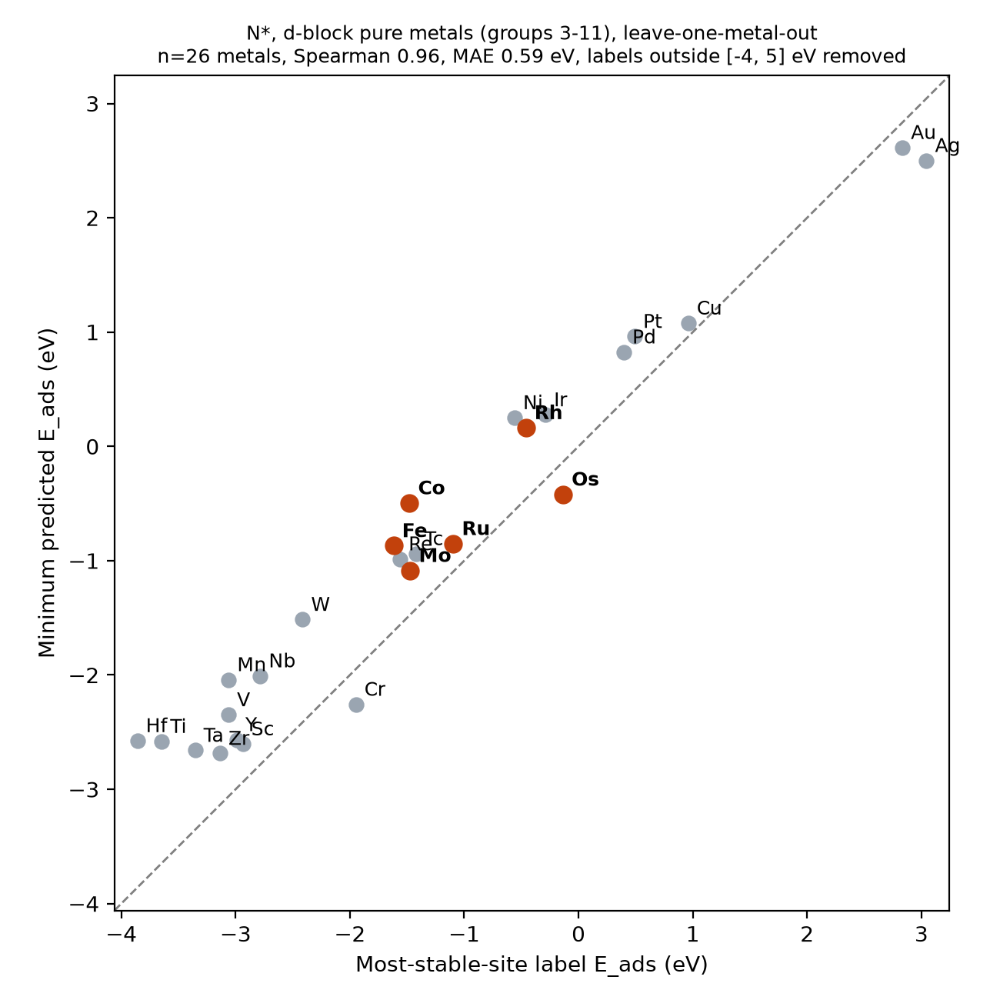

# Ammonia-AI M1: leak-free screening baseline (OC20 IS2RE; N*, N2*, NH*, NH2*, NH3*)

Draft of 2026-11-14. Contract `screening-v3-hb-unrelaxed-2026-11`. Models are untuned. Intervals are 95% bootstrap intervals over whole chemical systems and reflect test-set sampling only, not training variability.

## 1. Question and regime
Thermal Haber-Bosch screening with an unrelaxed slab plus adsorbate at a known site as input. Every feature comes from the initial frame. Last-frame, trajectory and energy quantities are audit-only and rejected by a registry gate and by name checks. The result is an adsorption-energy regressor, not a catalyst ranking: ranking needs a barrier layer (BEP or microkinetics) that OC20 does not provide.

## 2. Data and labels
- 45,558 OC20 IS2RE trajectories: N 12,123, NH 10,438, NH2 8,842, NH3 7,944, N2 6,211. The mapping pickle hash was verified, the join is one-to-one, and the folder adsorbate agrees with the mapping for every row.
- Label: E_ads = E_final - reference_energy (official OC20 reference, elemental N2/H2 basis).
- OC20 anomaly flags mark 11.7% of rows (N2 26.0%, NH3 27.9%). Regression is trained on the 40,208 clean rows. Anomaly classifiers and all-row metrics are reported separately.
- NH2 occurs only in the two OC20 "oos_ads" splits.

## 3. Features (64, element-free)
Adsorbate descriptors (numbers of N and H atoms, 2); Miller encodings (2); tabulated element properties (electronegativity, group, period) aggregated as mean/min/max/range over the bulk, the surface layer and the site atoms (36); transition-metal and non-metal fractions and element counts over the same three scopes (9); initial-frame geometry (7), topology (3) and coordination (5). Nine features are placement-sensitive. Element one-hot fractions were excluded: in the 12-element leave-element-out ablation they reached only 23% below the floor, against 42% for the property features.

## 4. Protocol
HistGradientBoosting, 200 iterations. Floor = (adsorbate, class) training mean. "Full" uses all 64 features, "light" the 55 that are not placement-sensitive. Evaluations: chemical-system grouped CV (3 repeats x 5 folds), the official OC20 split, true leave-element-out (54 elements; every bulk containing the element removed from training), NH2 held out of training.

## 5. Results (clean rows, MAE in eV)
| Adsorbate | Floor | Full [95% CI] | Light - full [CI] |
|---|---|---|---|
| All | 0.984 | 0.578 [0.564, 0.593] | +0.008 [+0.005, +0.010] |
| N | 1.386 | 0.694 [0.672, 0.718] | +0.013 [+0.008, +0.018] |
| N2 | 0.798 | 0.630 [0.605, 0.654] | +0.014 [+0.008, +0.021] |
| NH | 1.109 | 0.589 [0.571, 0.608] | +0.005 [+0.001, +0.009] |
| NH2 | 0.783 | 0.532 [0.513, 0.551] | +0.006 [+0.002, +0.010] |
| NH3 | 0.388 | 0.351 [0.335, 0.366] | -0.001 [-0.004, +0.003] |

- Class 0 (intermetallic) only: 0.464 [0.451, 0.479] against a floor of 0.927. By OC20 class (full): class 0 0.464, class 1 0.570, class 2 0.787, class 3 1.017 [0.907, 1.129].
- Spearman within adsorbate, class 0: N 0.89, NH 0.88, NH2 0.78, N2 0.68, NH3 0.56 (pooled over all surfaces and sites; not a catalyst ranking).
- Official split: val_is 0.610 [0.573, 0.654] (floor 1.062); val_oos_bulk, which shares no bulk with training, 0.582 [0.529, 0.650] (floor 1.033). NH2 is not in these splits.
- Leave-element-out (54 elements): mean 0.636 [0.591, 0.688] against a floor of 1.041; class 0 0.507 [0.465, 0.567] against 0.947; row-weighted 0.618 against 0.996. Class-0 values for Ru, Fe, Co, Os, Re, Mo: 0.383, 0.454, 0.433, 0.417, 0.424, 0.419 (floors 0.623, 0.790, 0.727, 0.608, 0.703, 0.746); these cover bulks containing the element, mostly alloys and compounds. The tested elements that fail are Sr (0.839 against 0.756) and Na (1.163 against 1.059); N* ranking is poor on bulks containing N, Cl, C, H or S.
- NH2 unseen (training without NH2): val_oos_ads 0.783 [0.756, 0.812] against a constant of 0.835, Spearman 0.734 [0.712, 0.754]; val_oos_ads_bulk 0.736 [0.700, 0.772] against 0.804, Spearman 0.696. Predictions are overspread (slope of truth on prediction 0.61-0.67).
- Anomaly classifiers (within-adsorbate AUC): desorbed N2 0.907, NH3 0.860; dissociated NH2 0.915, NH3 0.905, NH 0.920; surface-changed 0.84-0.89 for all adsorbates but with average precision of only 0.15-0.25. Dissociated N2 (33 rows) is not detectable (AUC 0.736 [0.635, 0.829], average precision 0.018).
- The clean-trained regressor on anomalous rows: better than the floor for dissociated (1.068 against 1.289) and desorbed (0.464 against 0.598) rows, worse than the floor for N2 surface changes (1.312 against 1.209). Its output should be trusted only for rows the classifier calls clean.
- Placement robustness: replacing the placement-sensitive features by medians gives 0.610 (light: 0.586). With random offsets of sigma = 0.25 A the full model scores 0.587 and at 0.5 A 0.612. Quote the light numbers (0.586; class 0 0.472) for candidates not placed by the OC20 recipe.

## 6. Verification
- Raw data, labels and joins audited (hash, coverage, adsorbate agreement); tests cover the schema, registry gate, readiness, candidate features and evaluation (including a test that audit columns in the table never reach the model).
- A recomputation of all 60 candidate columns with a different code path agreed on 28 systems (worst difference 7e-5, the 4-decimal storage precision); the typed element table agrees with pymatgen for 64 elements.

## 7. Limitations
- OC20 gives low-coverage RPBE adsorption energies: no barriers, coadsorbate effects or free-energy corrections. N2 dissociation, the key Haber-Bosch step, is essentially absent as a relaxation outcome (33 rows) and needs a BEP or microkinetic layer.
- Vacancies and doped surfaces are not in OC20; the data are perfect bulk truncations of 9,301 bulks. Coordination and site-element statistics are the only handle on under-coordination.
- A new candidate needs a site and a placement; OC20's placement recipe influences nine features.
- Label noise: 122 rows lie below -5 eV; slab restructuring is associated with the extremes (median maximum displacement 3.5 A for "surface changed" against 0.5 A otherwise), but displacement is not used as a filter.
- Untuned models; one run per element in leave-element-out; the 54 elements' test sets overlap.
- No retrodiction or volcano analysis yet.

## 8. Stage 1 (superseded for screening)
The earlier N*-only model (README: MAE 0.771 eV, R2 0.583) used final-frame features, random splits and a label-filtered 4,849-row subset. A reproduction with composition-grouped CV gives 0.786 with all features, 0.814 without the three final-frame ones and 0.823 with composition alone. Its site d-band feature was built without a cell, so it averaged over periodic images. These numbers are not comparable to Section 5.

## 9. Open items
run_all script and saved final model; moving legacy code; README note; a real re-placement test of the placement sensitivity; volcano ranking and retrodiction (M2).

## 10. Uncertainty (A5, full protocol: 5 folds, 200 iterations, 4 bootstrap models)

### 10.1 Protocol
- Chemical-system grouped 5-fold CV (GroupKFold on bulk_chemsys)
- 4 bootstrap models, each resampled by whole chemical systems (all rows of a system together)
- Per-adsorbate normalized conformal calibration: leave-one-fold-out; on each training fold, normalized residuals = raw_residual / (bootstrap_prediction_std / median_std); test quantiles computed per adsorbate at alpha=0.10 on out-of-group normalized residuals
- kNN applicability domain (95th percentile distance via inner 5-fold CV): flags for unseen element, far from training, magnetic metal in surface layer, non-metal rich surface
- Reliability tiers: high (no AD flags), medium (only magnetic flag), low (any other flag)

### 10.2 Prediction Interval Coverage
| Adsorbate | Coverage |
|---|---|
| N | 0.883 |
| N2 | 0.872 |
| NH | 0.883 |
| NH2 | 0.888 |
| NH3 | 0.898 |

| Tier | Coverage |
|---|---|
| high | 0.885 |
| medium | 0.872 |
| low | 0.914 |

| Adsorbate | high | medium | low |
|---|---|---|---|
| N | 0.885 | 0.860 | 0.905 |
| N2 | 0.865 | 0.885 | 0.920 |
| NH | 0.884 | 0.864 | 0.912 |
| NH2 | 0.888 | 0.875 | 0.920 |
| NH3 | 0.898 | 0.886 | 0.925 |

### 10.3 MAE by Tier
| Tier | MAE (eV) |
|---|---|
| high | 0.565 |
| medium | 0.502 |
| low | 0.851 |

### 10.4 Sharpness (Spearman Width vs |Error|)
| Adsorbate | rho | p-value |
|---|---|---|
| N | 0.184 | 6.8e-89 |
| N2 | 0.120 | 2.9e-16 |
| NH | 0.185 | 7.5e-79 |
| NH2 | 0.204 | 6.5e-78 |
| NH3 | 0.181 | 2.7e-43 |
| Overall | 0.228 | <1e-300 |

### 10.5 AD Flag Rates
| Flag | Rate |
|---|---|
| unseen element | 0.02% |
| far from training | 3.8% |
| magnetic | 14.3% |
| non-metal rich | 3.9% |

### 10.6 Limitations (uncertainty-specific)
(a) Conformal calibration residuals for training rows come from fold models that saw the test fold.  
(b) The ensemble standard deviation used to normalize calibration residuals is in-sample while test values are out-of-sample.  
(c) Interval widths only weakly track error (Spearman 0.23 overall).  
(d) Nominal coverage is 0.90 (alpha = 0.10, no finite-sample correction). Observed coverage is 0.872 to 0.898, below nominal for every adsorbate; N2 (0.872) also misses the 0.88 acceptance threshold used in validate_uncertainty.py.

## 11. Pure-metal leave-one-metal-out, N*

Per-row predictions from `results/m3/pure_metal_oof.csv`; script `scripts/generate_h4_figure.py`. For each pure metal: the most-stable-site label (minimum over clean N rows with labels in [-4, +5] eV) against the minimum predicted energy over the same metal's rows.

- 26 d-block metals (groups 3-11): Spearman 0.956, MAE 0.595 eV. All 48 elements: Spearman 0.917, MAE 0.746 eV.
- Groups 6-10 (15 metals): Spearman <FILL IN>, MAE <FILL IN> eV.
- Strong binders are compressed: Fe -1.62 vs -0.87, Co -1.48 vs -0.50, Mo -1.47 vs -1.09 eV (label vs prediction). Rh has a sign error (-0.46 vs +0.16 eV).
- Caveats: several metals have only 2-3 rows (Os, Mo, Pt, Ir), so the minimum is noisy; label and prediction minima often come from different facets; the all-metal ranking is dominated by the early-to-late trend. This is a ranking tool, not an E_N predictor at the 0.1-0.15 eV accuracy a barrier estimate would need.

Data note: 688 of 11,561 clean N rows (6%) have labels above +3 eV, concentrated in Hg, Ag-Au and sulfide/selenide/telluride/chloride compounds; 193 of them (28%) have N more than 1.5 A above the surface.
